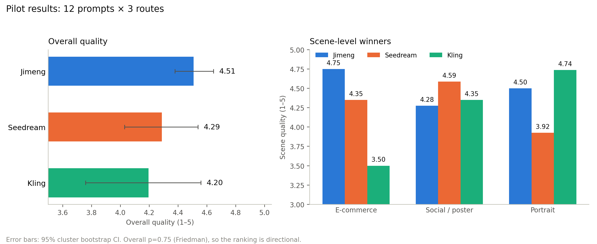

<div align="center">

# AIGC Image Quality Ops

**AIGC 生图平台的质量评测与数据质检复现**

即梦 / 可灵 / Seedream 4.0 · 原子约束 · 人工金标 · VLM 校准

[](https://github.com/lhh737/aigc-image-quality-ops/actions/workflows/ci.yml)
[](https://www.python.org/)
[](LICENSE)
[](NOTICE.md)
[](https://lhh737.github.io/aigc-image-quality-ops/dashboard/)

[中文](README.md) | [English](README.en.md)

</div>

---

## 概述

这个仓库记录一次 AIGC 生图平台的质量评测。pilot 用同一组提示词在即梦、可灵、Seedream 4.0 上生成图片，再做去水印盲化、人工标注、VLM 辅助评分和统计分析。

评测关注三件事：

- 提示词里的显式约束是否被满足；
- 图片是否达到可交付的视觉和商业质量；
- VLM 能在多大程度上用于初筛。

pilot 使用 12 条提示词，覆盖商品、海报、人像三个场景。原始生成图不在仓库中；仓库保留提示词、标注、分析结果和复现脚本。

- 在线看板：<https://lhh737.github.io/aigc-image-quality-ops/dashboard/>
- 结果摘要：[docs/results.md](docs/results.md)

## 结果



| 平台 | N | 综合质量 | 95% CI | 一次通过率 |
|---|---:|---:|---|---:|
| 即梦 | 12 | 4.51 | 4.38 – 4.65 | 91.7% |
| Seedream 4.0 | 12 | 4.29 | 4.03 – 4.54 | 75.0% |
| 可灵 | 12 | 4.20 | 3.76 – 4.56 | 66.7% |

- 电商商品图：即梦 4.75；社媒/海报：Seedream 4.59；人像：可灵 4.74。
- 三平台总体差异不显著（Friedman p=0.75），以上结果用于 pilot 阶段的方向判断。
- 人工与 VLM 的 Krippendorff's α 为 0.14–0.20；VLM 目前适合初筛，不作为最终判定依据。

## 评测流程

```text
Prompt + 原子约束
        │
        ▼
即梦 / 可灵 / Seedream 4.0
        │
        ▼
去水印 · 盲化 · 随机顺序
        │
        ▼
人工金标 + VLM 双变体
        │
        ▼
Bootstrap · Friedman · α · Bad Case
        │
        ▼
静态看板 + 评测摘要
```

## 方法

| 部分 | 做法 |
|---|---|
| 评测集 | 30 条 prompt（pilot 12 条），每条 5–8 个原子约束 |
| 评分 | G1 指令遵循、G2 视觉质量、G3 商业可用性；文字、一致性、安全按需启用 |
| 标注 | 人工金标 36 张；去水印盲化；VLM 使用 DeepSeek Flash，双 prompt 变体 |
| 统计 | 按 prompt 聚类 bootstrap、Friedman、Wilcoxon–Holm、Krippendorff's α |
| Bad Case | 失败标签、未满足的原子约束、低分样本三条线 |

细节见 [methodology](docs/methodology.md)、[rubric](docs/rubric.md)、[annotation SOP](docs/annotation_sop.md)。

## 快速开始

### 查看结果

仓库已包含分析所需的数据，不需要重新生成图片：

```bash
git clone https://github.com/lhh737/aigc-image-quality-ops.git
cd aigc-image-quality-ops
pip install -r requirements.txt

python -m src.pipeline.analyze --stage pilot --bootstrap 1000
python -m src.pipeline.build_dashboard
```

打开 `dashboard/index.html`，或使用在线看板。

### 完整复现

完整流程需要按 `prompts/prompts_v1.csv` 在平台生成图片，并在 `.env` 中配置 API Key：

```bash
cp .env.example .env
# 填写 DASHSCOPE_API_KEY / ARK_API_KEY / DEEPSEEK_API_KEY

python -m src.providers.standardize_manual --platforms jimeng,kling --apply
python -m src.providers.manual_ingest --platforms jimeng,kling --stage pilot
python -m src.pipeline.validate --stage pilot
python -m src.pipeline.blind --stage pilot --crop-bottom-pct 0.05
python -m src.pipeline.vlm_judge --stage pilot --variant both
python -m src.pipeline.analyze --stage pilot --bootstrap 1000
python -m src.pipeline.build_dashboard
```

标注工具见 [tools/annotation/README.md](tools/annotation/README.md)。

## 项目结构

| 路径 | 内容 |
|---|---|
| `prompts/` | 30 条 prompt、原子约束、pilot 清单 |
| `configs/` | 平台、模型、参数与采集方式 |
| `src/providers/` | 手动入库、Seedream/Qwen 适配器、文件标准化 |
| `src/pipeline/` | 校验、盲化、VLM 评分、分析、看板 |
| `tools/annotation/` | 本地静态标注工具 |
| `dashboard/` | 静态看板与生成结果 |
| `data/` | manifest、人工标注、VLM 评分、分析输出 |
| `docs/` | 方法、评分规则、标注 SOP、结果、限制、视频延伸 |

## 文档

| 文档 | 内容 |
|---|---|
| [docs/methodology.md](docs/methodology.md) | 评测设计与统计口径 |
| [docs/rubric.md](docs/rubric.md) | 评分维度与锚点 |
| [docs/annotation_sop.md](docs/annotation_sop.md) | 标注流程与重测 |
| [docs/results.md](docs/results.md) | pilot 结果与 Bad Case |
| [docs/limitations.md](docs/limitations.md) | 限制与适用范围 |
| [docs/video_extension.md](docs/video_extension.md) | 视频质检延伸设计 |

## 数据说明

**包含**：prompt、manifest、盲化映射、人工标注、VLM 评分、分析结果、看板数据。

**不包含**：原始生成图、盲化图、API Key、VLM 缓存。

原始图不公开的原因是平台条款、图片版权和隐私。prompt、标注和 manifest 足以复核评测方法；复现图片需要按记录的模型版本重新生成。

`data/manifests/blind_map.csv` 仅用于把 `blind_id` 映射回平台和 run，便于运行分析；盲化图本身不在仓库中。

## 限制

- 12 条 prompt 的 pilot，整体差异不显著，结论是方向性的。
- 产品级评测，闭源平台会改写提示词并做后处理，不等同于裸模型对比。
- 平台版本会变化，结果对应 2026-10-19 的版本。
- 目前只有一名人工标注者，48 小时重测尚未完成；VLM 与人工的 α 较低。
- 重复生成稳定性子集尚未采集。

完整说明见 [docs/limitations.md](docs/limitations.md)。

## License

- 代码：[MIT](LICENSE)
- 评测数据与报告：[CC BY-NC 4.0](NOTICE.md)

平台名称与生成图片归各自平台所有；本项目为非商业评测。详见 [NOTICE.md](NOTICE.md)。
